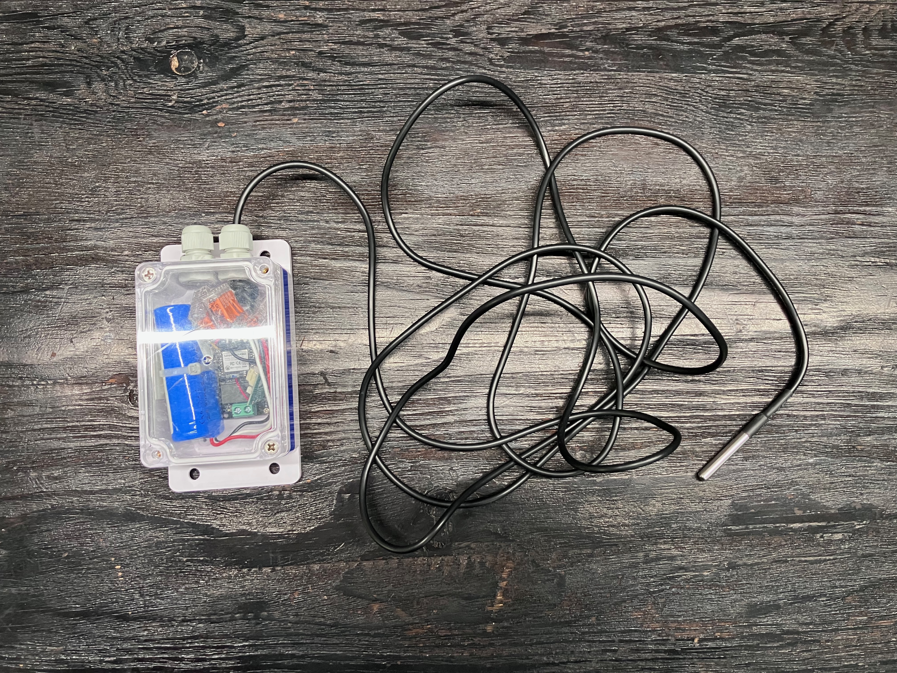
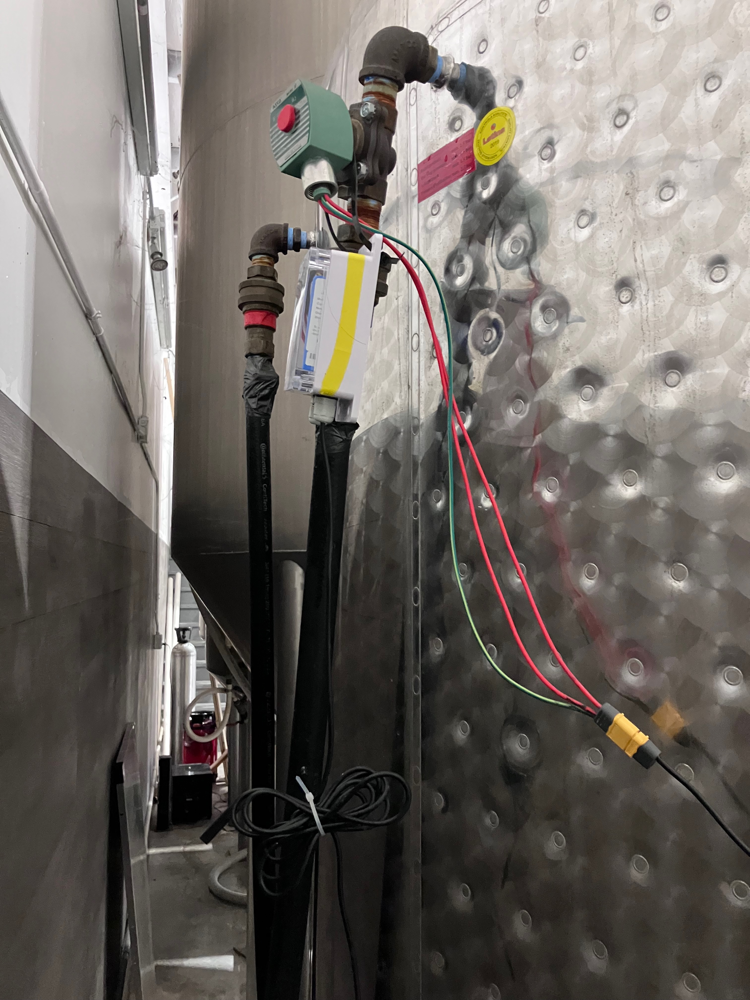
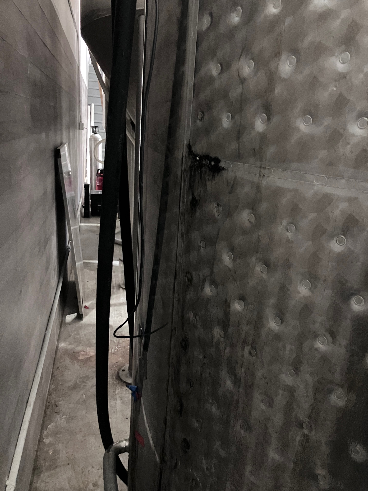
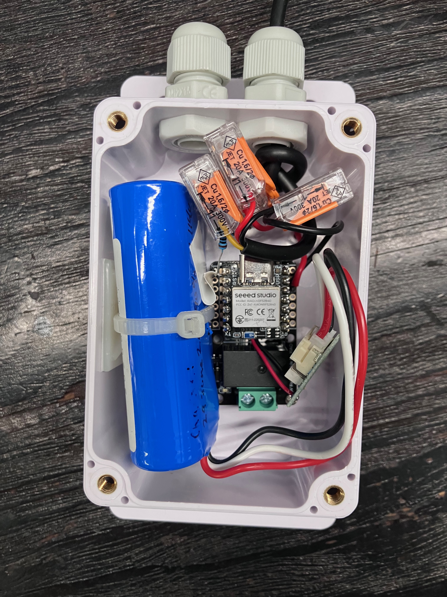
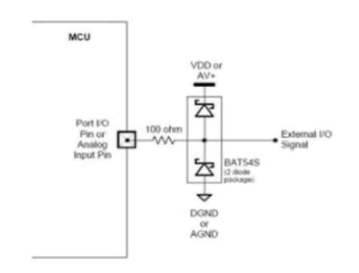
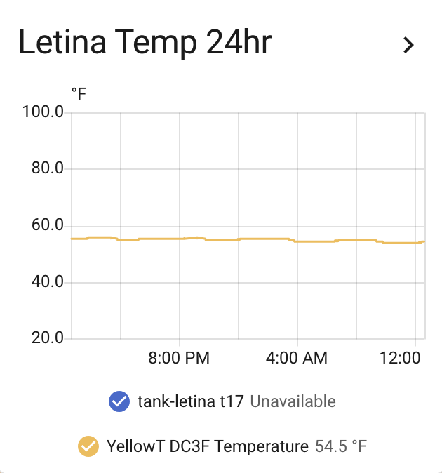
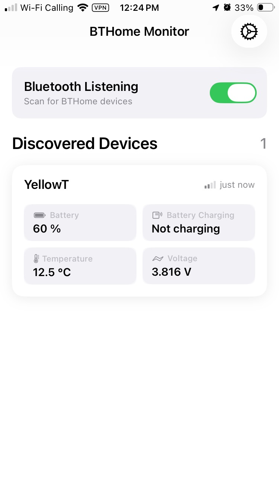

# wine-tank-fermentation-temperature-monitor

A battery-powered, waterproof temperature probe for monitoring fermenting wine. It broadcasts readings over Bluetooth LE using the [BTHome v2](https://bthome.io/) format, so Home Assistant picks it up automatically (no hub, no gateway, no pairing) 

One 18650-class lithium cell runs it for roughly a year. Insert the probe in the tank thermowell, hang the enclosure on the outside.





---

## Why

Commercial tank probes are expensive and usually wired. This is a $40 build that reports every minute and shows up as a native sensor in Home Assistant.

## Features

- **DS18B20 waterproof probe** — stainless steel, 12-bit resolution, +- 1.0 C / 1.8 F
- **BTHome v2 advertisements** — auto-discovered by Home Assistant, easily added to Shelly Plug, no custom integration
- **~1 year battery life** on a single lithium cell (60 s interval, light sleep between readings)
- **Reports temperature, battery percentage, battery voltage, charge status**
- **Status LED** flashes blue / yellow / red as a battery-level indicator before each transmit
- **Works with any BTHome receiver** — Home Assistant, or a phone app for a quick spot check



---

## Bill of materials

| Part | Notes |
|---|---|
| Seeed **Grove Base** for XIAO (or **Grove Relay Base**) | Carrier board; relay version gives you a spare switched output on D1 |
| **Seeed XIAO nRF52840** | The MCU. Has built-in Li-ion charging and battery sense |
| **Lithium battery** | Any single-cell Li-ion/LiPo. Bigger cell, longer runtime |
| **DS18B20 waterproof probe** | Stainless sheath on a long lead |
| **4.7 kΩ resistor** | 1-Wire bus pull-up, data line to 3V3 |
| **100 Ω resistor** | Series current limit into the MCU pin |
| **2 × BAT85** Schottky diodes | ESD / overvoltage clamp to the rails |
| **Wago connectors** | Splicing the probe lead; easy to open |
| Enclosure, cable gland | Whatever survives your cellar |

> **Note on the probe cable.** A long lead into a stainless tank is a good antenna for static and for anything else in the winery. The clamp diodes are not optional if you want this to survive a season.

---

## Wiring

```
                          3V3
                           │
                           ├──── DS18B20 VDD (red) ----------
                           │                                │
                        [4.7kΩ]                           BAT85   
                           │                                │
XIAO D0 ────[100Ω]─────────┴────────────────────────── DS18B20 DATA (yellow)
                                                            │
                                                          BAT85
                                                            │
                                                            │
                     GND   ──── DS18B20 GND (black) ---------
```

- **D0** — 1-Wire data, through the 100 Ω series resistor
- **4.7 kΩ** pull-up from the data line to 3V3 (required by the 1-Wire bus)
- **BAT85 pair** clamps the data line to 3V3 and GND: one anode-to-data / cathode-to-3V3, one anode-to-GND / cathode-to-data
- Probe VDD to 3V3, probe GND to GND

### Input protection

Standard MCU I/O protection: series resistance to limit fault current, Schottky clamps to shunt anything outside the rails.



The reference figure shows a BAT54S, which is just the same two-diode arrangement in a single SOT-23 package. Two discrete BAT85s do the same job. Either works — what matters is that they're Schottky (low forward drop, so they conduct before the MCU's internal ESD diodes do) and that the 100 Ω sits between the clamp point and the pin.

---

## Firmware

`code.py` is CircuitPython. Tested on CircuitPython 10.x for the Seeed XIAO nRF52840.

### Required libraries

Copy these from the [CircuitPython library bundle](https://circuitpython.org/libraries) into `/lib` on the `CIRCUITPY` drive:

- `adafruit_onewire`
- `adafruit_ds18x20`

`alarm`, `watchdog`, `microcontroller`, and `_bleio` are all built into the firmware.

### Installing

The board runs `code.py` immediately on boot, which makes it awkward to overwrite while it's busy advertising and light-sleeping. Do it in this order:

1. Plug in USB and wait for the `CIRCUITPY` drive to appear.
2. **Delete `code.py`.**
3. Reboot the board.
4. Copy the new `code.py` across (Thonny works well).
5. Reboot again. The new `code.py` runs.

If the drive won't stay mounted long enough, double-tap reset to enter the bootloader, or hold the button on boot for safe mode.

### Configuration

At the top of `code.py`:

```python
DEVICE_NAME = "YellowT"       # <= 10 bytes; this is the BLE advertised name
INTERVAL    = 60           # seconds between advertisements
REBOOT_AFTER_S = 24 * 3600 # deliberate daily restart
DEBUG       = True         # False = far fewer heap allocations in the loop
MAX_SENSOR_FAILS = 5       # consecutive DS18B20 errors before rebooting
```

Give each tank its own `DEVICE_NAME`. This is how you'll tell them apart in Home Assistant. Keep it to 10 bytes or the advertisement won't fit in 31 bytes.

Set `DEBUG = False` for deployment. It cuts allocations in the main loop and saves a little power.

---

## What it broadcasts

A single non-connectable BTHome v2 advertisement, unencrypted, sent for a few hundred milliseconds every `INTERVAL` seconds:

| Object ID | Measurement | Format |
|---|---|---|
| `0x00` | Packet ID | uint8, increments and wraps at 255 |
| `0x01` | Battery | uint8, percent |
| `0x02` | Temperature | sint16, 0.01 °C |
| `0x0C` | Voltage | uint16, 0.001 V |
| `0x16` | Battery charging | bool |

Temperature is quantized to the nearest 0.5 °F before transmit (`STEP = 5/18` °C). The DS18B20's real accuracy is ±0.5 °C, so finer resolution just produces jitter in your history graphs. If you'd rather have raw hundredths, set `STEP` to a smaller value or skip the quantization line.

### Power behaviour

- LEDs are switched **off** immediately before `start_advertising()`. They load the supply enough to cost several dB of RSSI on a small cell — worth knowing if your tank is far from the receiver.
- Between transmits the board sits in `alarm.light_sleep_until_alarms()`.
- The hardware watchdog is armed at `INTERVAL * 2 + 5` seconds. Anything that hangs the loop resets the board.
- The board deliberately resets itself once a day.

### LED codes

| Colour | Meaning |
|---|---|
| Blue | Battery above 50% |
| Yellow (blue + green) | Battery 20–50% |
| Red, flashing at boot | DS18B20 not found on the bus |

---

## Home Assistant

Nothing to configure. With the BTHome integration enabled and a Bluetooth adapter or ESPHome BLE proxy in range, the device appears as a discoverable entity within a minute or two. Accept it and you get temperature, battery, voltage, and charging entities.



A couple of things worth setting up once it's in:

- An alert if temperature is too high, or if the sensor stops reporting for 15 minutes
- A low-battery notification at 20%

For a quick check without opening Home Assistant, any BTHome-aware scanner app like [BTHome Monitor](https://apps.apple.com/bg/app/bthome-monitor/id6752530680) for ios will show the readings live.



---

## Range and placement

BLE advertisements at +8 dBm through a field of stainless tanks and a concrete cellar are not guaranteed. If you're getting dropouts, an ESPHome Bluetooth proxy on a spare ESP32 within line of sight of the tanks costs almost nothing and fixes it completely. 

---

## Troubleshooting

**"DS18B20 not found" and a flashing red LED.** The bus scan is failing. Check the 4.7 kΩ pull-up first. This is the single most common cause. Then check the splices in the wago connectors, and that the probe's red/black leads aren't swapped. The board retries 20 times and then reboots.

**Board reboots every few minutes.** Sensor reads are failing. Set `DEBUG = True` and watch the serial console for the actual exception. Intermittent 1-Wire failures on a long probe lead usually mean a marginal pull-up or a bad splice.

**Nothing appears in Home Assistant.** Confirm the device is advertising with a phone scanner first — that isolates the sensor from the receiver. If it's advertising but not discovered, check that your HA box or BLE proxy adapter is actually in range.

**Board is in safe mode.** Usually a brownout on a low cell. Charge it. `reboot()` calls `microcontroller.on_next_reset(RunMode.NORMAL)` so deliberate resets always come back running `code.py`.

---

## Roadmap

See the notes in `code.py`:

- Power the DS18B20 from D1 instead of the 3V3 rail. This lets the device deep-sleep with the sensor powered down, and allows a hard reset of a sensor.
- Reset after 8 full wraps of the packet ID (0–255) instead of on a roughly 24-hour timer
- Temperature sensor calibration
- Read configuration from `settings.toml` instead of editing constants in `code.py`
- Support for resistance NTC/RTD sensors
- Multiple DS18B20 or RTD probes on separate pins (D0–D10) for multi-zone tanks
- BTHome encryption key support

---

## License

GPL3. 

Please feel fee to use it, break it, improve it.
